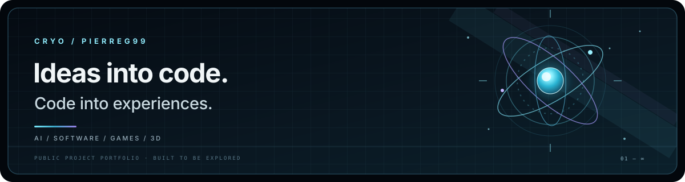

  <a href="https://pierreg99.github.io/Pierreg99-Profile-Page/">Live-Portfolio</a> ·
  <a href="https://pierreg99.github.io/Pierreg99-Profile-Page/docs/animation-gallery.html">Visuelles Labor / Visual laboratory</a> ·
  <a href="./docs/README.md">Dokumentation / Documentation</a> ·
  <a href="./assets/cryo-header.svg">Kanonischer CRYO-Header / Canonical identity vector</a>

  
  
  

# CRYO / Pierreg99

**DE:** Ein zweisprachiges Portfolio für Software, Browser-Games, interaktive 3D-Welten und KI-Experimente — mit direktem Zugang zu Demos, visuellen Studien und Quellcode.

**EN:** A bilingual portfolio for software, browser games, interactive 3D worlds, and AI experiments — with direct access to demos, visual studies, and source code.

## Bewegtes System / Motion showcase

<table>
<tr>
<th width="50%">CRYO Pulse · Identity / Status</th>
<th width="50%">CRYO Orbit · Engineering / Systems</th>
</tr>
<tr>
<td></td>
<td></td>
</tr>
<tr>
<td>**DE:** Ein leuchtender Kern und konzentrische Impulse bilden die CRYO-Identität in Bewegung. **EN:** A luminous core and concentric pulses form the CRYO identity in motion.</td>
<td>**DE:** Orbitale Ringe stehen für Verbindungen zwischen Ideen, Technologien und Systemen. **EN:** Orbital rings represent connections between ideas, technologies, and systems.</td>
</tr>
</table>

Die GIFs oben sind die versionierten Original-Assets. Im [visuellen Labor](https://pierreg99.github.io/Pierreg99-Profile-Page/docs/animation-gallery.html) beginnt jede Szene mit einem Standbild; die Website lädt das optimierte lokale MP4 erst nach einer Wiedergabeaktion. Jedes Motion-Element bietet außerdem **GIF ansehen** und **Original-GIF herunterladen**. Die Wiedergabe respektiert reduzierte Bewegung.

The GIFs above are the versioned original assets. In the [visual laboratory](https://pierreg99.github.io/Pierreg99-Profile-Page/docs/animation-gallery.html), each scene starts with a still; the site loads its optimized local MP4 only after the visitor starts playback. Each motion study also exposes **View animated GIF** and **Download original GIF** links. Playback respects reduced-motion preferences.

## Ausgewählte Projekte / Featured work

<table>
<tr>
<td width="50%" valign="top">

<h3>Cryoplane</h3>

<strong>DE:</strong> Flug durch eine polygonale Polarlandschaft mit Wegpunkten, Instrumenten-HUD und Radar. <strong>EN:</strong> Fly across a low-poly polar landscape with waypoints, an instrument HUD, and radar.

<a href="https://pierreg99.github.io/Cryoplane-Polygonal-Flight/">Live-Demo / Play</a> · <a href="https://github.com/Pierreg99/Cryoplane-Polygonal-Flight">Quellcode / Source</a>

</td>
<td width="50%" valign="top">

<h3>Cyberdash</h3>

<strong>DE:</strong> Neon-Rhythmus-Plattformer mit 16 Levels, CRYO-Eissektor, Level-Editor und reaktiver Audio-Engine. <strong>EN:</strong> A neon rhythm platformer with 16 levels, a CRYO ice sector, level editor, and reactive audio engine.

<a href="https://pierreg99.github.io/Cyberdash-Rhythm-Platformer-GAME/">Live-Demo / Play</a> · <a href="https://github.com/Pierreg99/Cyberdash-Rhythm-Platformer-GAME">Quellcode / Source</a>

</td>
</tr>
<tr>
<td width="50%" valign="top">

<h3>Call of Groky</h3>

<strong>DE:</strong> Browser-FPS-Prototyp mit Missionszielen, Waffensteuerung und taktischer HUD-Oberfläche. <strong>EN:</strong> A browser FPS prototype with mission objectives, weapon handling, and a tactical HUD.

<a href="https://pierreg99.github.io/call-of-groky/">Live-Demo / Play</a> · <a href="https://github.com/Pierreg99/call-of-groky">Quellcode / Source</a>

</td>
<td width="50%" valign="top">

<h3>Cryo Progress</h3>

<strong>DE:</strong> Öffentliches Fortschrittsprotokoll mit datierten Statusangaben; private Arbeiten erscheinen nur unter Codenamen. <strong>EN:</strong> A public progress ledger with dated status entries; private work is represented only by codenames.

<a href="https://pierreg99.github.io/progress/">Fortschritt / Explore</a> · <a href="https://github.com/Pierreg99/progress">Quellcode / Source</a>

</td>
</tr>
</table>

## Funktionen / Features

- **Öffentlicher Repository-Explorer / Public repository explorer:** Suchfeld sowie Filter für Domäne, primäre Sprache, eigene Projekte und öffentliche Forks. / Search and filters for domain, primary language, original projects, and public forks.
- **DE / EN:** Sprachumschaltung in der Website; Projektbeschreibungen und Galerie-Texte bleiben zwischen Homepage, Explorer und visueller Galerie abgestimmt. / Runtime language switching with consistent project descriptions across the homepage, explorer, and gallery.
- **Performance:** Responsive WebP-Varianten, lokale Fonts, lazy-loaded Bilder, optimierte Motion-Derivate und keine externe API-Abhängigkeit zur Laufzeit. / Responsive WebP variants, self-hosted fonts, lazy-loaded images, optimized motion derivatives, and no runtime API dependency.
- **Barrierefreiheit / Accessibility:** Semantisches HTML, Tastaturbedienung, sichtbare Fokuszustände und Unterstützung für `prefers-reduced-motion`. Desktop- und Mobile-Browserprüfungen ergänzen Axe-Checks für WCAG 2.2. / Semantic HTML, keyboard operation, visible focus, reduced-motion support, desktop/mobile browser tests, and Axe checks for WCAG 2.2.
- **Datenintegrität / Data integrity:** Das versionierte Inventar basiert auf öffentlichen GitHub-Metadaten. Private Repository-Namen werden nicht veröffentlicht; Sprachanteile zählen Projekte nach GitHubs primärer Sprache, nicht Codezeilen. / The versioned inventory uses public GitHub metadata only. Private repository names are never published; language shares count projects by GitHub primary language, not lines of code.

## Öffentlicher Bestand / Public inventory

<!-- inventory:start -->
The synchronized inventory contains **51 public repositories**. The account summary records **110 repositories** (**59 private**); private names are never published. The public list comes from GitHub's public user API; the private count is a preserved aggregate from the progress hub.
<!-- inventory:end -->

Der Snapshot, die Account-Zusammenfassung und die Sprachdaten lassen sich einzeln prüfen. / The snapshot, aggregate account summary, and language data are independently inspectable.

- [Öffentlicher Repository-Snapshot / Public repository snapshot](./assets/sync/public-repositories.json)
- [Aggregierte Account-Zusammenfassung / Aggregate account summary](./assets/sync/account-summary.json)
- [Sprach-Dashboard / Language dashboard](https://pierreg99.github.io/Pierreg99-Profile-Page/docs/public-language-dashboard.html)
- [Dokumentationsindex / Documentation index](./docs/README.md)
- [Asset-Katalog / Asset catalog](./assets/ASSET-CATALOG.md)

## Lokal entwickeln / Local development

**Voraussetzungen / Requirements:** Node.js 22+, npm 10+, Python 3.12+ und `ffmpeg`.

~~~sh
npm ci
npm run dev
~~~

Der lokale Server läuft unter `http://localhost:4173`. Für den Produktions-Build und die vollständigen Prüfungen:

The local development server runs at `http://localhost:4173`. Build and verify the production version with:

~~~sh
npm run build
npm run check
npx playwright install --with-deps chromium
npm run test:browser
npm run preview
~~~

`npm run sync` aktualisiert die öffentlichen Repository-Metadaten und den Snapshot. / `npm run sync` refreshes public repository metadata and the snapshot.

## Projektstruktur / Project structure

~~~text
src/
  components/   Reusable page sections, cards, media and navigation
  pages/        Homepage and generated static-page routes
  client/       Search, filters, language and motion behavior
  data/         Project records, asset registry and translations
  styles/       Shared responsive design system
assets/
  animations/   Canonical original GIFs
  projects/     Project screenshots and artwork
  sync/         Versioned public metadata snapshots
scripts/        Build, asset preparation, sync and validators
tests/          Unit, Python and Playwright browser checks
.github/
  workflows/    Validation and GitHub Pages deployment
~~~

## Grenzen / Scope

Visuelle Animationen illustrieren Design und Konzept; sie sind kein technischer Leistungsnachweis. Historische Forschungswerte behalten ihr ursprüngliches Datum und ihre dokumentierten Einschränkungen.

Motion and concept artwork illustrate visual design; they are not technical proof by themselves. Historical research values retain their original dates and documented limitations.
