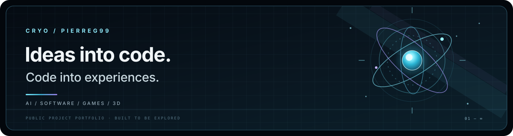
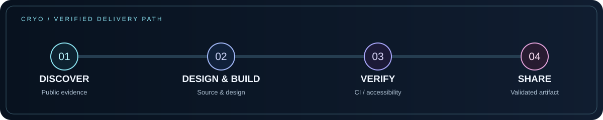
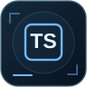
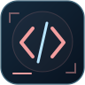
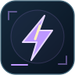
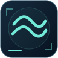
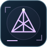
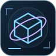
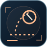
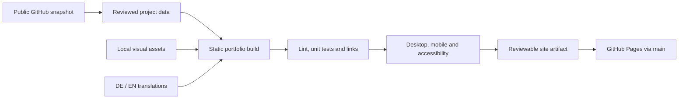

<div align="center">



# CRYO / Pierreg99

**Ideas into code. Code into experiences.**

**DE:** Ein zweisprachiges Portfolio für Software, KI-Experimente, Browsergames und interaktive 3D-Welten.  
**EN:** A bilingual portfolio for software, AI experiments, browser games, and interactive 3D worlds.

<p>
  <a href="https://github.com/Pierreg99/Pierreg99-Profile-Page/actions/workflows/deploy-pages.yml"></a>
  <a href="./assets/sync/public-repositories.json"></a>
  <a href="https://github.com/Pierreg99/progress"></a>
</p>

[**Live Portfolio**](https://pierreg99.github.io/Pierreg99-Profile-Page/) · [**Technology Atlas**](https://pierreg99.github.io/Pierreg99-Profile-Page/#stack) · [**Visual Laboratory**](https://pierreg99.github.io/Pierreg99-Profile-Page/docs/animation-gallery.html) · [**Docs**](./docs/README.md)

</div>

---

## Explore

| Discover | Understand | Verify |
| --- | --- | --- |
| [Technology Atlas](#technology-atlas) · [Featured Work](#featured-work) · [Motion Laboratory](#motion-laboratory) | [Architecture](#architecture) · [Quickstart](#quickstart) · [Documentation](#documentation-and-evidence) | [Validation](#validation) · [Public Inventory](#public-inventory) · [Scope](#scope-and-limitations) |

## From Ideas to Evidence



**DE:** Die Übersicht verbindet Ideen mit prüfbaren Ergebnissen: Code, Demos, CI, Tests und dokumentierten Grenzen. Kein erfundener Release-Status und keine unbewiesenen Skill-Prozente.

**EN:** The portfolio connects ideas to inspectable results: source, demos, CI, tests and stated limitations. Technology tiles are not proficiency certificates or evidence of production deployment.

## Technology Atlas

Zwölf **lokale, original gestaltete SVG-Icons** decken alle zwölf Technologie-Einträge der Website ab. Jede Kachel führt zu öffentlichem Quellcode oder einem Paketmanifest.  
Twelve original, local SVG icons cover all current website stack entries. Each tile links to public code evidence. **Illustrative CRYO icons, not official brand logos.**

### Programming Languages & Markup

| TypeScript | JavaScript | Python | HTML / CSS |
| --- | --- | --- | --- |
| <a href="https://github.com/Pierreg99/call-of-groky/blob/main/package.json"></a> | <a href="https://github.com/Pierreg99/Pierreg99-Profile-Page/blob/main/src/pages/home.js"></a> | <a href="https://github.com/Pierreg99/Pierreg99-Profile-Page/blob/main/scripts/sync_profile_assets.py"></a> | <a href="https://github.com/Pierreg99/Pierreg99-Profile-Page/blob/main/src/styles/index.css"></a> |
| <sub>Typed browser games</sub> | <sub>Interactive web interfaces</sub> | <sub>Repository automation</sub> | <sub>Markup and responsive CSS</sub> |

### Frameworks & Tooling

| React | Vite | Express | Tailwind CSS |
| --- | --- | --- | --- |
| <a href="https://github.com/Pierreg99/Nexo-Jarvis-AI-Futuristic-Assistant-Alpha/blob/main/package.json"></a> | <a href="https://github.com/Pierreg99/call-of-groky/blob/main/package.json"></a> | <a href="https://github.com/Pierreg99/Nexo-Jarvis-AI-Futuristic-Assistant-Alpha/blob/main/package.json"></a> | <a href="https://github.com/Pierreg99/Cryoplane-Polygonal-Flight/blob/main/package.json"></a> |
| <sub>Component-based interfaces</sub> | <sub>Frontend build workflow</sub> | <sub>Node.js services</sub> | <sub>Utility-first styling</sub> |

### Engines, Graphics & Physics

| Three.js | React Three Fiber | Cannon-es | Custom game systems |
| --- | --- | --- | --- |
| <a href="https://github.com/Pierreg99/call-of-groky/blob/main/package.json"></a> | <a href="https://github.com/Pierreg99/Nexo-Jarvis-AI-Futuristic-Assistant-Alpha/blob/main/package.json"></a> | <a href="https://github.com/Pierreg99/call-of-groky/blob/main/package.json"></a> | <a href="https://github.com/Pierreg99/Cyberdash-Rhythm-Platformer-GAME"></a> |
| <sub>3D browser scenes</sub> | <sub>React-driven 3D</sub> | <sub>3D physics</sub> | <sub>Rhythm and level editing</sub> |


**Evidence boundary:** A declared dependency is evidence of a package declaration, not necessarily production use. / Eine Paketabhängigkeit belegt keine Veröffentlichung oder praktische Expertise.

[Interactive Atlas](https://pierreg99.github.io/Pierreg99-Profile-Page/#stack) · [English Stack Reference](./docs/en/TECH-STACK-EN.md) · [Deutsche Stack-Referenz](./docs/de/TECH-STACK-DE.md)

## Featured Work

<table>
<tr><td width="50%" valign="top">
  <a href="https://pierreg99.github.io/Cryoplane-Polygonal-Flight/"></a>
  <h3>Cryoplane</h3>
  <p><strong>EN:</strong> Low-poly flight world, HUD and radar.<br><strong>DE:</strong> Polygonale Flugwelt mit Cockpit und Radar.</p>
  <p><a href="https://pierreg99.github.io/Cryoplane-Polygonal-Flight/">Live demo</a> · <a href="https://github.com/Pierreg99/Cryoplane-Polygonal-Flight">Source</a></p>
</td>
<td width="50%" valign="top">
  <a href="https://pierreg99.github.io/Cyberdash-Rhythm-Platformer-GAME/"></a>
  <h3>Cyberdash</h3>
  <p><strong>EN:</strong> Neon rhythm platformer and editor.<br><strong>DE:</strong> Neon-Plattformer mit Level-Editor.</p>
  <p><a href="https://pierreg99.github.io/Cyberdash-Rhythm-Platformer-GAME/">Live demo</a> · <a href="https://github.com/Pierreg99/Cyberdash-Rhythm-Platformer-GAME">Source</a></p>
</td></tr>
<tr><td width="50%" valign="top">
  <a href="https://pierreg99.github.io/call-of-groky/"></a>
  <h3>Call of Groky</h3>
  <p><strong>EN:</strong> Experimental 3D browser FPS.<br><strong>DE:</strong> Experimenteller 3D-Browser-FPS.</p>
  <p><a href="https://pierreg99.github.io/call-of-groky/">Live demo</a> · <a href="https://github.com/Pierreg99/call-of-groky">Source</a></p>
</td>
<td width="50%" valign="top">
  <a href="https://pierreg99.github.io/progress/"></a>
  <h3>Cryo Progress</h3>
  <p><strong>EN:</strong> Public dated progress journal.<br><strong>DE:</strong> Öffentliches Fortschrittsprotokoll.</p>
  <p><a href="https://pierreg99.github.io/progress/">Live demo</a> · <a href="https://github.com/Pierreg99/progress">Source</a></p>
</td></tr>
</table>

**DE:** Die Projektbilder verweisen auf öffentlich verfügbare Arbeiten. Konzeptgrafiken sind von funktionalen Screenshots zu unterscheiden.  
**EN:** Project artwork and screenshots represent public work; conceptual visuals are identified separately from functional evidence.

[Public Project Explorer](https://pierreg99.github.io/Pierreg99-Profile-Page/#projects) · [Language Dashboard](https://pierreg99.github.io/Pierreg99-Profile-Page/docs/public-language-dashboard.html)

## Motion Laboratory

<table>
<tr><th>CRYO Pulse / Identity</th><th>CRYO Orbit / Systems</th></tr>
<tr><td></td><td></td></tr>
</table>

Die GIF-Dateien sind versionierte Originale. Auf der Website werden Videos erst auf Anfrage geladen und reduzierte Bewegung wird respektiert. / The GIFs are versioned originals. Website videos load on request and respect reduced-motion preferences.

[Visual Lab](https://pierreg99.github.io/Pierreg99-Profile-Page/docs/animation-gallery.html) · [CRYO Canonical Header](./assets/cryo-header.svg) · [Asset Catalog](./assets/ASSET-CATALOG.md)

## Architecture



**Static first:** Modules in `src/` generate static HTML, CSS and JavaScript. The versioned snapshot drives the public inventory; the browser does not require live GitHub API access. The workflow validates pull requests and only deploys from `main`.

```text
src/
  components/      Accessible cards, navigation and technology atlas
  data/            Reviewed descriptions, metadata and translations
  pages/           Home, galleries, research and documentation
  client/          Optional filters, language and motion behavior
  styles/          Responsive CRYO design system
assets/
  technology/      Twelve original technology icons
  animations/      Versioned source GIFs
  projects/        Public project imagery
  sync/            Versioned public metadata snapshot
scripts/           Build, asset preparation and verification
tests/             Node, Python and Playwright checks
.github/workflows/ Validation and GitHub Pages publication
```

[Architecture EN](./docs/en/ARCHITECTURE-EN.md) · [Architektur DE](./docs/de/ARCHITECTURE-DE.md) · [Design System](./docs/en/PROFILE-DESIGN-SYSTEM-EN.md)

## Quickstart

**Requirements / Voraussetzungen:** Node.js 22+, npm 10+, Python 3.12+ and `ffmpeg`.

```bash
git clone https://github.com/Pierreg99/Pierreg99-Profile-Page.git
cd Pierreg99-Profile-Page
npm ci
npm run dev
```

Local server / Lokaler Server: **http://localhost:4173**.

```bash
npm run check
npx playwright install --with-deps chromium
npm run test:browser
npm run preview
```

`npm run check` runs source linting, unit checks, production build, link validation and offline metadata integrity checks. `npm run test:browser` exercises the desktop/mobile frontend and accessibility. `npm run sync` refreshes public snapshots deliberately and updates the inventory block below.

## Validation

| Gate | Verification | Purpose |
| --- | --- | --- |
| Source style | `npm run lint` | ESLint and Prettier |
| Unit checks | `npm test` | Node.js and Python |
| Static build | `npm run build` | Deployable HTML and optimized assets |
| Sources and links | `npm run validate` | Local references and public snapshot integrity |
| Browser and accessibility | `npm run test:browser` | Desktop/mobile Playwright and Axe |
| Real CI result | [Validate and Deploy CRYO Profile](https://github.com/Pierreg99/Pierreg99-Profile-Page/actions/workflows/deploy-pages.yml) | Actual run status, not decorative claims |

Only real checks justify a green status. / Nur tatsächlich bestandene Prüfungen begründen einen grünen Status.

## Public Inventory

<!-- inventory:start -->
The synchronized inventory contains **35 public repositories**. The account summary records **94 repositories** (**59 private**); private names are never published. The public list comes from GitHub's public user API; the private count is a preserved aggregate from the progress hub.
<!-- inventory:end -->

**DE:** Die Zahlen werden durch den Sync-Workflow aktualisiert. Private Repository-Namen werden nicht veröffentlicht.  
**EN:** These counts are synchronized snapshots, not a live API response. Private repository names are excluded.

[Public Repository JSON](./assets/sync/public-repositories.json) · [Aggregate Account Summary](./assets/sync/account-summary.json) · [Progress Hub](https://github.com/Pierreg99/progress)

## Documentation and Evidence

| Resource | Content |
| --- | --- |
| [Docs Index](./docs/README.md) | DE/EN technical references |
| [Technology Stack EN](./docs/en/TECH-STACK-EN.md) / [DE](./docs/de/TECH-STACK-DE.md) | Technology context and limitations |
| [Language References EN](./docs/en/PROGRAMMING-LANGUAGES-EN.md) / [DE](./docs/de/PROGRAMMING-LANGUAGES-DE.md) | Public-language methodology |
| [CRYO Design System](./docs/en/PROFILE-DESIGN-SYSTEM-EN.md) | Accessible layouts, local assets and colors |
| [Asset Catalog](./assets/ASSET-CATALOG.md) | Original SVGs, GIFs, screenshot provenance |
| [Research Archive](https://pierreg99.github.io/Pierreg99-Profile-Page/dashboard/) | Dated historical analyses |

## Scope and Limitations

- Public project counts are synchronized snapshots. GitHub primary-language labels are per repository, not lines of code or proficiency measurements.
- A dependency declaration does not prove deployment. Local symbols are original artwork, not official logos.
- Private repository names are never enumerated on the public page; only a preserved aggregate may be shown.
- Historical benchmarks and visual concept artwork are not independent performance certification.
- Public source access is not a substitute for checking licensing and third-party reuse conditions.

**DE:** Das Ziel ist eine zugängliche, glaubwürdige Dokumentation mit überprüfbaren Quellnachweisen.  
**EN:** The goal is an accessible, credible portfolio that makes evidence and uncertainty visible.

---

<div align="center">
  <a href="https://pierreg99.github.io/Pierreg99-Profile-Page/">Live portfolio</a> ·
  <a href="https://github.com/Pierreg99">GitHub</a> ·
  <a href="./assets/cryo-mark.svg">CRYO identity</a>
</div>
